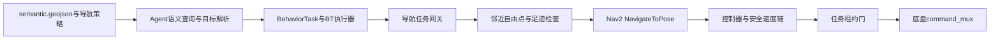
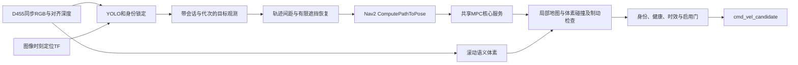

> 2026-10-13 维护说明：本文中的 `.maintenance` 路径是历史记录。该目录无运行依赖，按用户要求清理；保留的原始测试报告、日志和哈希清单迁入 `/home/orin/ros2_ws/docs/validation/maintenance-history/`，按原分组名查找，完整列表见该目录 `manifest.json`。源码/安装备份压缩包和依赖缓存已清理，不能再按旧路径恢复。历史结果未在本次清理中重跑。

> 当前人物链已于2026-10-12改为相对靠近/跟随：不使用map/odom/Nav2，2026-10-13已移除Agent检测开关，NAV感知进程收到新鲜图像即检测，Agent仅管理人物执行，Agent反馈为detected/what/id/yaw/distance。实时B不再有map坐标；家具A存图和已存语义导航保留。详见 [当前接口与入口](Agent共享检测与YOLO模型接入.md)。下文先前人物Nav2/MPC、实时map反馈和旧启动参数仅为历史记录。新代码已构建不等于常驻底盘服务已重启或完成实车验收。

> 2026-10-12 当前感知链更新：YOLO/BoT-SORT 与实时深度/TF投影由 ros2_ws 的 nav_yolo_detector 承担；Agent 仅消费 nav 结果并按 B 白名单适配 observations/context。家具 A 与人物跟随共用 nav raw，导航意图/控制权机制保持既有接线。详见 [nav 统一检测与 Agent 反馈](Agent共享检测与YOLO模型接入.md)。后文中 Agent 作为默认 YOLO 发布者的描述是迁移前记录。

# 人物跟随合入与系统链路核验

核验日期：2026-10-12。对象为现场 `/home/orin/ros2_ws`、`/home/orin/person_follow_upgrade_ws_20261010` 与原 Agent 工程。依据为本次 SSH 只读取证、逐文件摘要、源码审计、当前构建及隔离回归；历史迁移包和 10 月 10 日的 49 项测试不作为本轮通过证据。

## 1. 实际集成范围

- 升级原 `ros2_ws/src/wla_person_follow`，新增 `ros2_ws/src/wla_follow_mpc`。
- 原 `wla_diff_mpc` 导出 `wla_diff_mpc_core` 共享库。Nav2 插件和跟随服务都链接它。保留原插件 ID `wla_diff_mpc::DiffMpcController`，不在跟随包保留第二份 QP/solver/reference 源码。
- 更新 `wla_r680_navigation` 的地图定位门禁、导航/建图入口互斥与统一入口；更新 `wla_behavior_bridge` 的任务所有权检查。
- 新增 `ros2_ws/r680_person_follow.sh`。原 `r680_nav.sh`、`r680_mapping.sh` 根入口改为调用安装版本，避免根脚本与包内脚本漂移。
- 原 Agent 继续位于 `/home/orin/Wheel_Legged_Agent`；本轮不搬迁 Agent 模型、动作注册表或感知环境。
- 不自动启用底盘，不修改或重启常驻手动控制服务。跟随只生成候选，尚未拥有实际底盘任务租约。

备份及验证记录：`/home/orin/ros2_ws/.maintenance/person_follow_integration_20261012/`。原文件与相关安装产物在 `before.tar.gz`，安装摘要在 `installed-manifest.json`，测试与链接证据在 `validation/`。已有无关 Git 改动保留。

## 2. 这次查到的逻辑问题

|问题|触发条件及后果|本轮处理|
|---|---|---|
|跟随查不存在的轮速 TF|`/wheel/odom` 的 frame 是 `wheel_odom`，但驱动不发布该 TF；按图像时间变换目标会失败|位置改用 `/d455_slam/odom` 和主定位 TF；MPC 实测速度仍用 `/wheel/odom`|
|RGB-D 未匹配旧地图就报告定位正常|视觉里程计正常不代表已在保存的地图中定位|watchdog 与恢复 anchor 均要求地图匹配、近期定位 pose 和 TF；mapping 模式不启用这道旧图门禁|
|导航与建图可重复启动|复用常驻底盘后原串口进程检查被绕过，会出现多套 TF/guard|正式 source 入口共用按 ROS 域区分的 flock；根入口统一转发到 install|
|同域 DDS 不可见|CLI 与底盘的 CycloneDDS 网络配置不同|新入口与 nav/mapping 统一使用主工作区 manual_control 的 DDS 配置；显式隔离域不再静默改成 73|
|换人或感知进程重启后旧结果串用|仅进程内整数 epoch 不足以区分进程；PoseStamped 没有身份代次|增加 process session+target epoch；控制观测使用带身份字段的 target_measurement，旧 PoseStamped 仅作显示|
|推理超时或关开候选后沿用旧命令|迟到图像被当成当前实测；enable 前的 nav_command 仍未过期|按采集时间复核，换人/启停撤销缓存；命令检查 session、epoch、模式、时间|
|VO重置后沿旧目标轨迹继续|同一 odom frame 内坐标跳变、断连恢复没有新地图代次|超出运动连续性门限、frame变化或里程计断流恢复时清锁、禁用候选、增加代次|
|定位已经失效但新stamp里程计仍产生跟随候选|时间新鲜不等于定位可信|规划端和最终候选门同时要求localization_ready为true且0.5秒内更新；失效撤销缓存，恢复重新规划|
|查询预测位置改变了滤波时钟|控制线程读预测使后续图像观测融合到未来状态|预测读取不修改滤波采样状态|
|全局代价地图每秒反复过期|1 Hz 发布配 1秒 TTL，普通抖动就触发废弃路径|全局完整图 TTL 2.5秒；局部仍1秒，二者分别检查 ROS采样时间与接收时间|
|离散足迹采样漏掉圆周角落栅格|窄障碍与圆盘相交但没有命中采样点|精确检查圆盘与每个相交栅格方块；支持旋转origin、未知/越界拒绝|
|未启用跟随也占用共享规划器|选人后持续请求 ComputePathToPose|disabled 时撤销路径、停止发规划请求|
|靠近人后回头找历史站位／遮挡时猜错路口|按轨迹回溯忽略当前已到近距；直行评分低被误当唯一意图|近距直接停；多个可行恢复分支视为歧义并停车|
|坏体素帧后旧地图短暂继续有效|voxel失败状态没有被导航消费|发布空云立即撤销旧快照；传递实际体素resolution并严格校验标签|
|体素更新失败留下半张地图|容量超限途中已经清掉部分障碍|原子提交；错误标签/形状/地面高度拒绝，错误更新不改旧地图|
|MPC晚到、二次求解或非法姿态处理不全|第二次求解没有再次验首步变化；错误响应可带残留内容|复核首步与范围、姿态/坐标、总耗时；失败回复零速度和空预测；客户端清理超时pending|
|Agent活动任务借租约放行外来目标|另一个客户端发送Nav2目标，网关原先仅准入时检查外来任务|发送前登记自己的UUID，运行中发现外来目标即撤销租约、锁住控制权并定向取消自己；迟到claim不能重新解锁|

MPC 的“新限速优先”继承原核心：请求速度可以立即降到新上限，不是对底盘实际减速度的保证。碰撞/刹车检查使用未裁剪的实测轮速，并检查完整停车过程；真实制动参数仍需测量。

## 3. 功能逻辑链

### 地图语义导航



Agent 查询地标身份和位置；家具中心不是落脚点。网关要求地图版本、语义身份、已登记动作、控制权、定位与停车状态有效。接近点经过当前 costmap 全足迹检查和规划可达性检查；目标坐标通过 Action 进入导航，不发布到障碍层。完成/取消必须等正式 Action 结果与停车证据，不能只靠“已经发送”判定成功。

### 人物跟随



只有用户选择的可见有效目标才能被锁定；不自动选最近的人。丢失后仅有限时间内沿已知轨迹或唯一安全候选恢复，岔路歧义、超时、未知区域或传感器失效即停。当前是平地跟随，不包含台阶、跳跃、越障动作。

`navigation_backend=nav2` 在这里表示借用 Nav2 的几何规划，不是把跟随交给原 Nav2 controller_server。MPC 服务返回候选与预测轨迹，不发底盘速度；Nav2 插件和该服务共用数学核心，但拥有不同的上层控制流程。

### SLAM 与导航地图

```text
RGB-D → rgbd_odometry → EKF                         ┐
双目+IMU → cuVSLAM → 有限轮速/IMU连续里程计门       ├→ /d455_slam/odom
OpenVINS试验前端 → 质量门                           ┘  （前端互斥）

合格里程计 + RGB/深度 → RTAB-Map → 定位pose/info、map→odom、rtabmap.db
选中的 map.yaml/map.pgm → map_server → 静态导航图层
原始深度点云/scan → 原障碍层与清障 → 膨胀层 → 全局/局部costmap
家具YOLO A → 语义聚合 → semantic.geojson → Agent地图查询
实时YOLO B → observations → Agent当前检测查询
```

静态地图、SLAM数据库、地图语义和实时障碍必须保留不同职责。实时人物保持为碰撞对象；不能通过删除整个人框的点云清掉后方墙面。`nav2_voxel_overlay.yaml` 仅为未启用的预览参数块，不覆盖生产插件列表；marking-only 体素层没有完整清障生命周期，不能直接拿来替代生产障碍层。

## 4. TF 权威与时钟

|坐标边／数据|唯一来源|
|---|---|
|`map → d455_floor_odom`|当前 RTAB-Map 会话|
|`d455_floor_odom → r680_mapping_floor`|当前选中的 EKF / 连续里程计节点 / 验证前端之一|
|底盘到相机外参|单一外参发布者|
|相机内部 optical frames|RealSense驱动|
|`/wheel/odom`|wheeltec驱动；当前只提供Odometry，不提供wheel_odom TF|

图像时间用于同步深度与 TF；采样 ROS 时间用于判断观测年龄，monotonic 时间用于本机超时和租约。收到迟到消息不能给它重新计算一整段“新鲜期”。map 重定位可以改变 map→odom，跟随目标轨迹因此保存在连续 odom 中，再按当前变换规划；odom 本身跳变须撤销轨迹。

同frame跳变门限为 `0.25m + 1.5m/s × dt`、`0.35rad + 3rad/s × dt`，属于保守连续性门限，不是底盘能力标定，也不是离地识别。姿态异常只能发现部分抱起场景；平移抱起、轮子空转无法靠这些门限可靠识别。

## 5. 通信接口与机制

|接口|类型／机制|生产者 → 消费者|核验重点|
|---|---|---|---|
|D455 RGB、aligned depth、CameraInfo|sensor_msgs Topic，传感器QoS|驱动 → 跟随感知|同帧/近同步、源时间、图像尺寸与内参|
|`/d455_slam/odom`|Odometry，传感器订阅|定位 → 跟随位置|frame、单调时间、连续性与健康|
|`/wheel/odom`|Odometry，可靠发布、传感器订阅兼容|驱动 → MPC速度/仲裁/网关|位置不作为主TF；坏轮速立即失效|
|`/r680_nav/localization_ready`|Bool，周期健康|接口监控 → 运动门|必须持续新鲜，不能永久记住曾经true|
|`/tf`、`/tf_static`|TF2 Topic|唯一坐标权威 → 各节点|时间插值、外推、重复父边|
|global/local `costmap`|OccupancyGrid，Reliable+TransientLocal订阅|Nav2 → 跟随与语义网关|完整图、地图坐标、ROS年龄+接收年龄；不消费增量updates|
|`/compute_path_to_pose`|Nav2 Action|跟随/目标解析 → planner|接受、结果、取消；旧代次结果无效；避免并发争抢|
|`target_measurement`|String/JSON Topic|感知 → 跟随规划|session、epoch、stamp、frame_id、xy；跨话题不假定先后顺序|
|`target_observed`|PoseStamped Topic|感知 → 可视化|仅显示，不承担目标代次控制协议|
|`status`、`navigation_status`|String/JSON Topic|跟随节点 → 规划/诊断|状态、时间、身份与停止原因|
|`scene_points`|PointCloud2 x/y/z/label|感知 → 体素|测量时间与实际有限深度射线|
|`voxels`|PointCloud2，增加resolution字段|体素 → 碰撞检查|坏云立即空云撤销；旧客户端必须一起升级|
|`/r680/person_follow/compute_mpc`|自定义 ComputeMpc Service|跟随规划 → C++求解器|有界输入/耗时、request_id；客户端删除失联pending，服务无运动副作用|
|`nav_command`|String/JSON Topic|跟随规划 → 最终候选门|session/epoch/stamp/mode、限速及当前健康|
|`cmd_vel_candidate`|Twist Topic|跟随 → 观察/测试|当前没有底盘消费者，不能直接remap到驱动|
|`select_track_id` / `select_pixel` / `clear` / `enable`|Int32 / Point / Empty / Bool Topic|操作端 → 跟随|一次性指令，没有事务确认；以新status回执核实|
|`/wla_agent/semantic_command`|AgentSemanticCommand Service，JSON内容|Agent → 查询/意图API|地图/实时列表分开，缺位置返回null，导航需登记路由|
|BehaviorTask / NavigateToPose|Action|Agent → BT → 网关 → Nav2|请求身份、代次、goal UUID、定向取消、终态/停车确认|
|TaskLease|Topic周期心跳|Agent/BT/网关 → 任务门|所有者和代次匹配、超时撤销、不自动复活|
|`/r680_base/set_automatic`|SetBool Service|显式模式选择 → command_mux|手柄中立、轮速停车、自动零速流新鲜才接管|

JSON Topic 便于联调，但没有编译期字段约束。本轮新增严格解析和身份字段；后续公开Agent跟随接口宜使用带request_id、状态反馈、取消和租约的Action，不能把一次Topic发布当成长期任务。

## 6. 最终速度链与行为切换边界

```text
Nav2 MPC/MPPI controller
 → goal_approach_limiter → cmd_vel_nav → velocity_smoother
 → collision_monitor → command_guard
 → 普通模式：/r680_nav/chassis_cmd_vel
 → Agent模式：task_guard_input → TaskLease门 → 配置的最终输出
 → command_mux（AUTO时）→ /r680_base/cmd_vel → wheeltec → 底盘

手柄 → /r680_manual/cmd_vel → command_mux（MANUAL时）→ 底盘
跟随 → /r680/person_follow/cmd_vel_candidate → 当前止于此
```

|行为|当前状态|切换要求／缺口|
|---|---|---|
|语义地点导航|已有API、BT与Nav2链|需要当前地图、匹配租约及显式底盘自动许可；默认预览不动|
|人物跟随|正式workspace中可构建、生成隔离候选|还需接统一任务网关、停止交接、候选来源选择与碰撞/guard链；禁止直接接最终速度话题|
|停在人附近交互|可取消导航/关闭跟随候选并停车|长期“互动保持”状态和Agent跟随任务切换尚未统一|
|被抱起|部分姿态/定位故障会触发停止|缺可靠离地信号与carry状态；不能宣称已完整处理|
|无人自主探索/暂停续建|包与方案已有，完整行为未接通|需探索任务所有权、地图DB持久化/恢复、frontier重评估、重定位、充电桩语义和中断停车握手|

现有 AUTO 仍要求手柄持续连接。它满足当前人工值守策略，但不满足“没有手柄的无人自主探索”；不能直接删掉这道门，应以独立运行模式、急停/看门狗与任务许可替代后验证。MANUAL 绕过 Nav2 碰撞链，目的是定位失效时仍可人工移动，不能称为人工模式也自动避障。

Nav2其他 Action（NavigateThroughPoses、FollowPath、行为服务）以及手工直接发布Twist仍属于旁路边界；本轮外来目标监测覆盖 NavigateToPose。提供的脚本锁也不能阻止手工启动任意节点。正式无人系统应统一对外运动入口，限制旁路，避免仅依赖节点名或DDS话题名充当身份认证。

## 7. 当前资源与验证边界

现场确认原路径 `/home/orin/Wheel_Legged_Agent/.venv-perception/bin/python` 与 `models/yolo11n.pt` 不存在；系统Python有ROS/OpenCV/numpy，但无torch/ultralytics。启动脚本允许 `WLA_FOLLOW_PYTHON`、`WLA_FOLLOW_MODEL` 覆盖，并在启动前输出缺失项，不自动下载模型或创建另一套大型环境。

```bash
cd /home/orin/ros2_ws
./r680_person_follow.sh check
# 指向已有资源后：
WLA_FOLLOW_PYTHON=/absolute/path/to/python \
WLA_FOLLOW_MODEL=/absolute/path/to/yolo11n.pt \
./r680_person_follow.sh indoor
```

相机、定位和Nav2由原导航会话提供；此入口不隐式启动底盘或切入AUTO。即使使用 `/enable` 打开候选，当前仍不能据此宣称已实现实车跟随。

### 本轮验证结果

|检查|实际结果|证据（validation目录内）|
|---|---|---|
|正式ros2_ws构建|5个受影响包成功；后续跟随健康/足迹修复均重新构建|上一级build.log、health-rebuild.log、footprint-rebuild.log|
|人物跟随全套（含实际C++服务与ROS合成输入）|80 passed、0 skipped|follow-tests.xml/log；初始73项、健康75项历史记录分别保留|
|原MPC核心回归|colcon报告4项、0失败、0跳过|mpc-colcon-result.txt|
|原导航回归|colcon报告29项、0失败、0跳过|navigation-colcon-result.txt|
|真实RGB-D watchdog+入口锁|4 passed|system-regressions.xml|
|任务所有权回调竞态|安装版方法与真实TaskGateway核心，7 passed|gateway-ownership.xml|
|原Agent DDS/BT/网关链|8个合成场景通过|dds-smoke-result.json、agent-dds-smoke.log|
|原Nav2插件加载|pluginlib实际实例化成功；未configure运动|plugin-probe.log|
|共享核心动态链接|服务与原Nav2插件均链接正式workspace的同一core，依赖无not found|follow-mpc-linkage.txt、nav-mpc-linkage.txt|
|手动/自动仲裁|策略4项与隔离DDS接管场景|manual-policy.xml、manual-dds.log|
|缺模型时启动|正式入口预检拒绝；直接launch感知失败后其余3个节点自动正常退出|perception-preflight.json、launch-dependency-check.json|

没有将上述不同层级数字累加成“全系统测试总数”，colcon汇总还包含测试容器自己的计数。真实相机、YOLO推理、现场Nav2规划效果、实际制动与人物跟随运动均未验收。

保留的失败记录：最初尝试完整4节点launch时暴露感知资源缺失；之后添加关键进程退出时关闭整组的处理，并验证缺依赖时停止。测试清理时一次向整个launch进程组及其转发链重复送SIGINT产生KeyboardInterrupt，改为按启动器机制清理；另一次只对ros2 run父进程送信号无法结束子节点，已按隔离测试自身进程组清理并复测。没有停止生产域73的底盘服务。

旧manual DDS夹具仍按历史0.3m/s断言，而当前安装默认是1.0m/s。本轮验证副本只将断言改为当前参数，原源码测试未修改；没有通过修改底盘限速迁就旧测试。该证据是软件限幅与模式切换，不是1.0m/s实车验收。

## 8. 后续最优先的系统工作

1. 补齐感知Python/本地模型资源路径，在原相机驱动上做无运动实测，确认图像、TF、体素与定位健康的整链时延。
2. 在现有任务网关增加 FollowPerson 任务与唯一速度来源切换；必须“撤销旧租约→取消旧执行→确认停车→新代次接管”，再经同一安全链到command_mux。
3. 用实际测得的足迹、制动、旋转和地形能力替换当前保守参数，完成有人值守的低速直线、转弯、遮挡和紧急停止验收。
4. 再扩展 carry/interaction/explore 状态；持续建图恢复保存的是地图与探索任务信息，不是恢复旧速度或盲目执行旧frontier。

## 2026-10-12 后续：共享模型接入完成，验证边界更新

旧模型路径缺失是前一阶段状态。现已接入用户提供的YOLO11n权重，默认由Agent推理一次，家具A、实时B、人物跟随分别筛选；跟随不再要求独立torch/YOLO。主导航地图身份与健康接口已增加显式绑定模式。

参见 [Agent共享检测与YOLO模型接入](Agent共享检测与YOLO模型接入.md)：包含当前路径、启动参数、27/99项回归、真实模型/DDS/map坐标回放证据、尚未达标的时延与GPU架构警告，以及无预存图时的坐标方案。真实相机与人物跟随运动仍未验收，前文历史日志/数字不改写。
